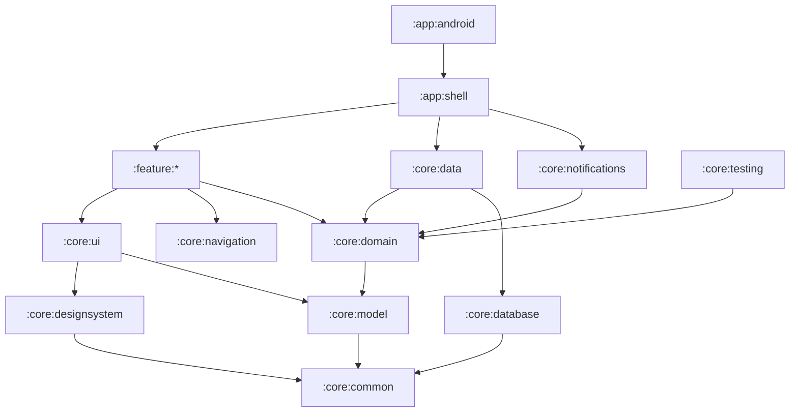

# Modules and dependency rules

Prumio is split into small Gradle modules with one responsibility each. The graph is a strict
layering: dependencies only point **down**. The rules below are not guidelines — they are
executed by `build-logic/convention/src/main/kotlin/app/prumio/buildlogic/ModuleRules.kt` and the
build fails at configuration time when one is broken.

Each module's `README.md` is its contract (purpose, public API, rules, tests). Its `CLAUDE.md`
imports that README so Claude Code loads it automatically.

## Catalog

| Module | Plugin | Purpose |
|---|---|---|
| `:app:android` | `prumio.android.application` | Android entry point: Application, MainActivity, manifest. Thin |
| `:app:shell` | `prumio.kmp.compose` | Shared root UI (`PrumioApp`), navigation host, bottom bar, DI module list |
| `:core:common` | `prumio.kmp.library` | `Outcome`, `TimeProvider`, `IdGenerator`, `DispatcherProvider` |
| `:core:model` | `prumio.kmp.library` | Entities, typed ids, enums — plain immutable data |
| `:core:domain` | `prumio.kmp.library` | Use cases, ports (interfaces), rule engines, `DomainError` |
| `:core:database` | `prumio.kmp.library` + SQLDelight | Schema, queries, migrations, platform driver |
| `:core:data` | `prumio.kmp.library` | Repository implementations, mappers, settings store, backup serializer |
| `:core:notifications` | `prumio.kmp.library` | Alarm scheduling and notification delivery (platform adapters) |
| `:core:designsystem` | `prumio.kmp.compose` | Theme tokens and generic `Prumio*` components; the only Material user |
| `:core:ui` | `prumio.kmp.compose` | Domain-aware shared components, labels, formatters, shared strings, `PrumioViewModel` |
| `:core:navigation` | `prumio.kmp.library` | Navigation keys and the `Navigator` contract |
| `:core:testing` | `prumio.kmp.library` | Fakes and helpers for tests |
| `:core:database-testing` | `prumio.kmp.library` | In-memory SQLite database for JVM tests (test-only) |
| `:feature:today` | `prumio.feature` | Today: day at a glance (reference implementation) |
| `:feature:agenda` | `prumio.feature` | Agenda and appointments |
| `:feature:matters` | `prumio.feature` | Matters: list, detail, history |
| `:feature:inbox` | `prumio.feature` | Inbox list and processing |
| `:feature:capture` | `prumio.feature` | Quick capture dialog ("Add anything") |
| `:feature:tasks` | `prumio.feature` | Task editor, detail and "All tasks" |
| `:feature:search` | `prumio.feature` | Search |
| `:feature:settings` | `prumio.feature` | Settings, reminder reliability, backup |
| `:tooling:architecture-tests` | `prumio.jvm.library` | Konsist tests enforcing these rules |

## Dependency graph

(Edges implied by transitivity are omitted. `:core:testing` and `:core:database-testing` are only consumed by test source sets.)

## Dependency rules

These are the exact rules of `ModuleRules.kt`. A module may depend **only** on what its row allows.
Any module may additionally use `:core:testing` and `:core:database-testing` from its test source sets
(and only from there).

| Module | May depend on | Why |
|---|---|---|
| `:app:android` | `:app:shell`, `:core:*` | Thin platform entry point; screens are reached through the shell |
| `:app:shell` | `:core:*`, `:feature:*` | Assembles features and core modules into one app |
| `:feature:*` | `:core:common`, `:core:designsystem`, `:core:domain`, `:core:model`, `:core:navigation`, `:core:ui` | Features talk to data only through domain ports and never to other features |
| `:core:ui` | `:core:common`, `:core:designsystem`, `:core:model` | Shared UI renders models; it never loads data |
| `:core:designsystem` | `:core:common` | Generic; knows nothing about Prumio's domain |
| `:core:data` | `:core:common`, `:core:database`, `:core:domain`, `:core:model` | Implements domain ports on top of the database |
| `:core:notifications` | `:core:common`, `:core:domain`, `:core:model` | Implements domain scheduling ports |
| `:core:domain` | `:core:common`, `:core:model` | Pure Kotlin business logic |
| `:core:database` | `:core:common` | Owns SQL only |
| `:core:testing` | `:core:common`, `:core:domain`, `:core:model` | Test doubles implement domain ports |
| `:core:database-testing` | `:core:common`, `:core:database` | The in-memory test database wraps the production schema |
| `:core:model` | `:core:common` | Plain data |
| `:core:navigation` | nothing | Leaf contract |
| `:core:common` | nothing | Bottom of the graph |
| `:tooling:*` | nothing | Inspects sources, does not link them |

### Consequences you will meet

- **A feature needs data** → it calls a use case from `:core:domain`, which talks to a repository
  *interface*. The implementation in `:core:data` is bound by Koin in `:app:shell`. Features never see SQL.
- **A feature needs to open another feature's screen** → it emits a navigation effect with a key
  from `:core:navigation`. It never imports the other feature.
- **Two features need the same composable** → move it to `:core:ui` (renders a domain type) or
  `:core:designsystem` (generic). Copying is forbidden (ADR-0008).
- **Something needs the Android `Context`** → it is platform code: put it in `androidMain` of the
  owning core module behind an interface declared in `commonMain` or `:core:domain`.

## Code-level rules on top of module rules

`:tooling:architecture-tests` adds checks Gradle cannot see: imports per layer, naming,
component catalog, file size, package names and rule traceability. See its
[README](../../tooling/architecture-tests/README.md).

## Adding or changing modules

- New feature module: [docs/ai/recipes/add-feature-module.md](../ai/recipes/add-feature-module.md).
- New core module or a change to these rules: requires an ADR and the owner's approval
  (AGENTS.md §6). Update this file, `ModuleRules.kt` and `settings.gradle.kts` in the same commit.
