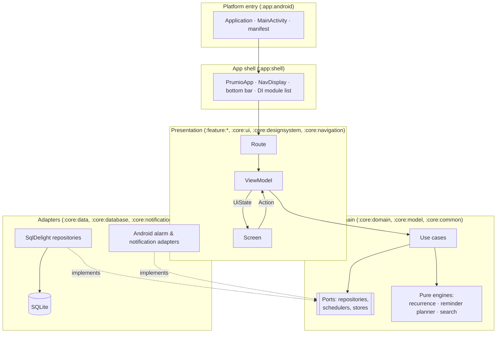

# Architecture overview

Prumio is a **modular, layered Kotlin Multiplatform app** with Android as its only target today.
It follows a simplified Clean Architecture: business rules in a pure-Kotlin domain at the center,
UI and storage as replaceable adapters around it, and dependencies that only point inward.

The design goal behind every choice: **an AI agent (or a new human) can change one thing safely by
reading one module and one recipe**, and the build tells it immediately when it broke a rule.

## Layers



| Layer | Knows about | Never knows about |
|---|---|---|
| Domain | Kotlin, coroutines, kotlinx-datetime | Android, Compose, SQL, Koin (except `di/`) |
| Adapters (data, notifications) | Domain ports, SQLDelight, Android APIs | UI, features |
| Presentation | Domain use cases and models, design system, navigation keys | SQL, Android alarms, other features |
| Shell | Everything (it assembles the app) | — |

The exact module graph and its enforcement: [modules.md](modules.md).

## How data flows

### Reading (reactive)

```
SQLite ──(SQLDelight query.asFlow)──▶ Repository Flow<List<Model>>
       ──▶ Use case combines/filters (domain rules) ──▶ ViewModel maps to UiState (StateFlow)
       ──▶ Screen renders state
```

Every list on screen is a live `Flow`: when data changes anywhere (another screen, a notification
action, an import), every visible screen updates by itself. No manual refresh, no event buses.

### Writing

```
Screen ──Action──▶ ViewModel.onAction ──▶ UseCase(input): Outcome<T, DomainError>
       ──▶ validates rules (BR-*) ──▶ Repository port (one transaction) ──▶ SQLite
       ──▶ Flows emit ──▶ screens update;   reminder reconciliation observes the change (phase 4)
       ◀── Outcome.Failure ──▶ ViewModel shows a message (Effect) or field error (State)
```

### Side effects that follow data

Reminders are a projection of the database (ADR-0006): changing data is enough; the reconciler
re-plans alarms. Features never call alarm or notification APIs.

## Key decisions

| Decision | Record |
|---|---|
| Kotlin Multiplatform, Android-first, iOS only on explicit request | [ADR-0001](../adr/0001-kotlin-multiplatform-android-first.md) |
| Compose Multiplatform UI with Navigation 3 | [ADR-0002](../adr/0002-compose-multiplatform-ui.md) |
| SQLDelight + SQLite, offline only | [ADR-0003](../adr/0003-sqldelight-persistence.md) |
| Koin for dependency injection | [ADR-0004](../adr/0004-koin-dependency-injection.md) |
| Unidirectional data flow: Contract/ViewModel/Route/Screen | [ADR-0005](../adr/0005-unidirectional-data-flow.md) |
| Notifications derived from data | [ADR-0006](../adr/0006-notifications-derived-from-data.md) |
| Modules with enforced dependency rules | [ADR-0007](../adr/0007-modular-architecture-enforced-rules.md) |
| Design system as the single source of UI components | [ADR-0008](../adr/0008-design-system-single-source.md) |
| No network access at all | [ADR-0009](../adr/0009-no-network-access.md) |
| Business rule ids and traceability | [ADR-0010](../adr/0010-business-rule-traceability.md) |
| UUID ids, sync-ready model | [ADR-0011](../adr/0011-uuid-identifiers.md) |
| Next actions are tasks linked to matters | [ADR-0012](../adr/0012-next-actions-are-linked-tasks.md) |
| Floating vs zoned time | [ADR-0013](../adr/0013-time-semantics.md) |
| Exact alarm strategy | [ADR-0014](../adr/0014-exact-alarm-strategy.md) |
| Application id and namespace | [ADR-0015](../adr/0015-application-id-and-namespace.md) |
| Android system backup enabled | [ADR-0016](../adr/0016-android-system-backup.md) |
| Documentation and repository designed for AI agents | [ADR-0017](../adr/0017-ai-first-repository.md) |

## Where does my code go?

| I am writing… | Module | Package / file |
|---|---|---|
| A business rule or operation | `:core:domain` | `<aggregate>/<Verb><Noun>UseCase.kt` |
| A new field or entity | `:core:model` (+ schema, mappers) | `<Entity>.kt` |
| SQL | `:core:database` | `sqldelight/app/prumio/core/database/<table>.sq` |
| Persistence of a port | `:core:data` | `<aggregate>/SqlDelight<Aggregate>Repository.kt` |
| A screen | `:feature:<x>` | `XxxContract/ViewModel/Route/Screen.kt` |
| A generic UI element | `:core:designsystem` | `component/Prumio<Name>.kt` |
| How a domain object looks | `:core:ui` | `component/<Entity>Row.kt` |
| A label or format for a model value | `:core:ui` | `label/` or `format/` |
| A destination | `:core:navigation` + the owning feature | `PrumioNavKeys.kt`, `<Feature>Navigation.kt` |
| Android-only code | the owning core module | `src/androidMain/` behind an interface |
| A test double | `:core:testing` | `Fake<Port>.kt` |

## Reference implementation

The Today greeting is a complete, minimal vertical slice that every new feature copies:

- Rule: `BR-TODAY-001` in [business-rules.md](../domain/business-rules.md)
- Model: `core/model/.../DayPeriod.kt`
- Use case + tests: `core/domain/.../today/GetDayPeriodUseCase.kt`, `GetDayPeriodUseCaseTest.kt`
- Label: `core/ui/.../label/DayPeriodLabels.kt` (+ en/pt-BR strings)
- Screen: `feature/today/.../TodayContract.kt`, `TodayViewModel.kt`, `TodayRoute.kt`, `TodayScreen.kt`
- ViewModel tests: `feature/today/src/commonTest/.../TodayViewModelTest.kt`
- Wiring: `TodayFeatureModule.kt`, `TodayNavigation.kt`, registered in `:app:shell`
