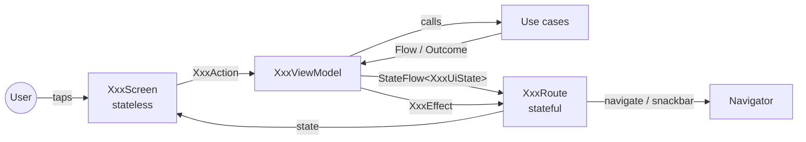

# Presentation pattern

Every screen uses the same unidirectional data flow (ADR-0005), with the same four files. The
Today screen is the reference implementation — copy it.



## The four files

### `XxxContract.kt` — what the screen is

```kotlin
internal data class XxxUiState(        // everything the screen shows; immutable; defaults = initial
    val items: List<TaskUi> = emptyList(),
    val isEmpty: Boolean = true,
)

internal sealed interface XxxAction {  // everything the user can do
    data class CompleteTask(val id: TaskId) : XxxAction
    data object OpenSettings : XxxAction
}

internal sealed interface XxxEffect {  // things that happen once
    data class Navigate(val key: NavKey) : XxxEffect
    data class ShowMessage(val message: UiMessage) : XxxEffect
}
```

Reading only this file must be enough to understand the screen's behavior.

### `XxxViewModel.kt` — the logic of the screen

```kotlin
internal class XxxViewModel(
    private val observeSomething: ObserveSomethingUseCase,
    private val completeTask: CompleteTaskUseCase,
) : PrumioViewModel<XxxUiState, XxxAction, XxxEffect>(XxxUiState()) {

    init {
        viewModelScope.launch {
            observeSomething().collect { data -> updateState { it.copy(items = data.map(::toUi)) } }
        }
    }

    override fun onAction(action: XxxAction) {
        when (action) {
            is XxxAction.CompleteTask -> viewModelScope.launch {
                completeTask(action.id).onFailure { sendEffect(XxxEffect.ShowMessage(it.toUiMessage())) }
            }
            XxxAction.OpenSettings -> sendEffect(XxxEffect.Navigate(SettingsKey))
        }
    }
}
```

Rules:
- 🔒 Extends `PrumioViewModel` (`:core:ui`), is `internal`, lives in a feature module.
- Depends only on use cases (and `TimeProvider` when it needs "now" for display). Never on
  repositories, SQL, Android classes or other ViewModels.
- No business rules: it maps domain results to UI state. If you write an `if` about a business
  concept (overdue, needs attention), it belongs in a use case or policy.
- Navigation decisions are effects (`Navigate(key)`), so they are testable.

### `XxxRoute.kt` — the stateful glue

```kotlin
@Composable
internal fun XxxRoute(navigator: Navigator, modifier: Modifier = Modifier, viewModel: XxxViewModel = koinViewModel()) {
    val state by viewModel.state.collectAsStateWithLifecycle()
    val showMessage = rememberMessageSender()
    CollectEffects(viewModel.effects) { effect ->
        when (effect) {
            is XxxEffect.Navigate -> navigator.navigate(effect.key)
            is XxxEffect.ShowMessage -> showMessage(effect.message)
        }
    }
    XxxScreen(state = state, onAction = viewModel::onAction, modifier = modifier)
}
```

The only place where the ViewModel, Koin and the `Navigator` meet the UI.

### `XxxScreen.kt` — pure rendering

```kotlin
@Composable
internal fun XxxScreen(state: XxxUiState, onAction: (XxxAction) -> Unit, modifier: Modifier = Modifier) {
    PrumioScaffold(modifier = modifier, topBar = { PrumioTopBar(title = stringResource(…)) }) { padding ->
        // Prumio* and :core:ui components only
    }
}

@Preview @Composable
private fun XxxScreenPreview() { PrumioTheme { XxxScreen(state = XxxUiState(/* sample */), onAction = {}) } }
```

Rules: stateless (no ViewModel, no Koin, no `remember` of business data); reports every intent as
an action; at least one `private` preview with realistic data; uses only design-system and
`:core:ui` components.

## Plus two wiring files per feature

- `XxxNavigation.kt`: `fun EntryProviderScope<NavKey>.xxxEntries(navigator: Navigator)` with one
  `entry<Key> { XxxRoute(…) }` per screen.
- `XxxFeatureModule.kt`: `val xxxFeatureModule = module { viewModelOf(::XxxViewModel) }`.
  ViewModels that need a navigation argument use `viewModel { params -> XxxViewModel(params.get(), …) }`
  and the Route passes `koinViewModel { parametersOf(key.id) }`.

## Messages and Undo

Short feedback ("Task deleted", "Couldn't save") is a snackbar drawn by the single
`PrumioSnackbarHost` that `PrumioApp` places in its scaffold. There is no message bus: the flow is
always **ViewModel effect → Route → `rememberMessageSender()`**, so it is testable like any effect.

- The ViewModel emits `XxxEffect.ShowMessage(UiMessage(...))`. Text is a `StringResource` (+ args):
  ViewModels never hold resolved strings.
- Failures: `result.onFailure { sendEffect(XxxEffect.ShowMessage(it.toUiMessage())) }`.
  `DomainError.toUiMessage()` (`:core:ui/message`) is the only error → text mapping; validation
  errors shown under a field use `DomainError.Validation.fieldMessage()` instead.
- The Route maps the effect to `showMessage(effect.message)`; it returns at once.

**Undo (BR-GEN-005).** The ViewModel keeps what is needed to restore the item and puts the restore
in `onAction`; the snackbar stays ≥ 5 s when it has an action:

```kotlin
is XxxAction.Delete -> viewModelScope.launch {
    deleteTask(action.id).onSuccess { deleted ->
        sendEffect(
            XxxEffect.ShowMessage(
                UiMessage(
                    text = Res.string.task_deleted,
                    actionLabel = Res.string.action_undo,
                    onAction = { onAction(XxxAction.Restore(deleted)) },
                ),
            ),
        )
    }.onFailure { sendEffect(XxxEffect.ShowMessage(it.toUiMessage())) }
}
```

Test it like any effect: assert the `ShowMessage` effect, invoke `message.onAction`, then assert
the item is back (`awaitItem()` on `effects`, Turbine).

## UI models

When a screen needs presentation-specific data (a formatted label, a flag combining fields),
map domain models to small `XxxUi` data classes in the ViewModel. Keep formatting of dates and
times in composables via `:core:ui` formatters (they depend on locale), not in the ViewModel.

## Testing a screen

- ViewModel: `runViewModelTest { }` with fakes; assert `state.value` and `effects` (Turbine).
  Name tests after the rule they prove. See `TodayViewModelTest`.
- Screen: previews, plus screenshot tests (`ScreenshotTest` from `:core:screenshot-testing`) of
  realistic states in light, dark and 200 % font. See [testing strategy](testing-strategy.md#screenshot-tests).
