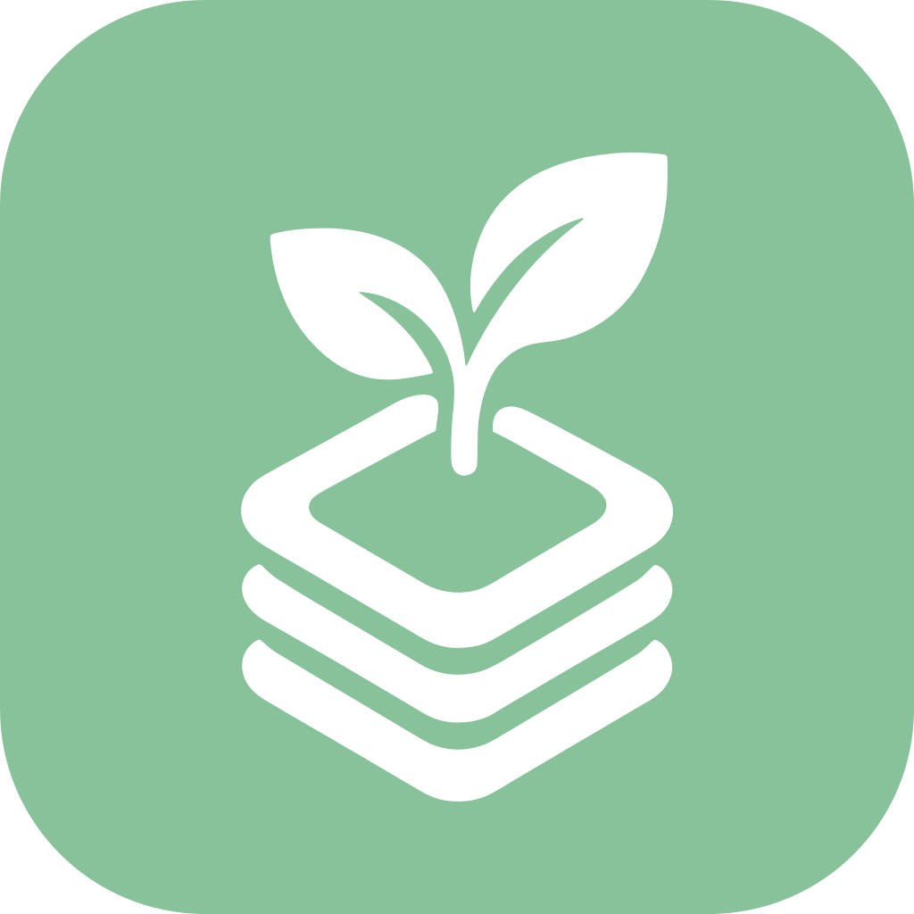

# Brand

Prumio's identity: one mark, one color. Use them exactly as described here.



## The mark

A sprout growing out of three stacked layers: life's commitments kept in order (the layers) and
the mind left free to grow (the sprout). It pairs with the name *Prumio* (from *prumo*, the plumb
line: balance and direction).

## Prumio Green

| | Value | Use |
|---|---|---|
| **Prumio Green** | `#88C29A` · RGB 136 194 154 | Logo background, brand surfaces, FAB, selected states (token `brand`, and `primaryContainer` in the light theme / `primary` in the dark theme) |
| On Prumio Green (logo) | `#FFFFFF` | Only the mark itself (token `onBrand`) |
| On Prumio Green (UI text/icons) | `#0C2715` | Text and icons placed on green surfaces (token `onPrimaryContainer`, light theme) |

White text on Prumio Green has a contrast of 2.05:1 — **never put white text on it**. The full
palette derived from this green is in [design-system/tokens.md](../design-system/tokens.md).

## Files

All files in [`logo/`](logo/) are generated; never edit them by hand.

| File | Use |
|---|---|
| `prumio-logo.svg` | Square, full green background, white mark. Store listings, social avatars (platforms round it themselves), docs |
| `prumio-logo-rounded.svg` | Rounded app-icon shape on transparent background. README, website, presentations |
| `prumio-logo-1024.png`, `prumio-logo-512.png`, `prumio-logo-rounded-1024.png` | Raster exports of the above |
| `prumio-mark.svg` | Mark only, in Prumio Green, transparent. Light backgrounds |
| `prumio-mark-white.svg` | Mark only, white. On Prumio Green or photos/dark surfaces |
| `prumio-mark-dark.svg` | Mark only, dark green `#0C2715`. Monochrome print, light gray backgrounds |

In code:

| Asset | Where | Generated from |
|---|---|---|
| Android launcher icon | `app/android/src/main/res/mipmap-anydpi/ic_launcher.xml` (adaptive: background `@color/ic_launcher_background` = Prumio Green, foreground/monochrome `drawable/ic_launcher_foreground.xml`) | mark, scaled to 52 dp tall so it stays inside the 66 dp safe zone |
| In-app logo | `PrumioLogo` (`:core:designsystem`) using `composeResources/drawable/prumio_mark.xml` | mark, 24-unit viewport, tinted at runtime |

## Usage rules

**Do**
- Use `PrumioLogo` for every in-app appearance (today: the Today top bar via `PrumioTopBar(showBrandMark = true)`).
- Keep clear space around the mark of at least 25 % of its height.
- Minimum size: 16 dp (in app) / 24 px (print and web).
- Use the green mark on light backgrounds and the white mark on Prumio Green or dark backgrounds.

**Don't**
- Recolor the mark with anything other than Prumio Green, white or `#0C2715`.
- Stretch, rotate, outline, add shadows or gradients, or rearrange the sprout and layers.
- Put the mark on busy backgrounds or low-contrast colors.
- Redraw or approximate the mark: use the generated files.

## Regenerating assets

The source of truth is the traced path `source/prumio-mark-path.txt` (traced from the original
artwork `source/prumio-logo-original.webp`, 99.5 % pixel overlap).

```bash
python3 scripts/brand/generate_brand_assets.py          # SVGs + Android vectors
for f in prumio-logo prumio-logo-rounded; do
  inkscape docs/brand/logo/$f.svg --export-type=png --export-width=1024 --export-filename=docs/brand/logo/$f-1024.png
done
inkscape docs/brand/logo/prumio-logo.svg --export-type=png --export-width=512 --export-filename=docs/brand/logo/prumio-logo-512.png
```

To trace a new version of the artwork, see the header of `scripts/brand/trace_logo.py`. A change
of the mark or of Prumio Green is a brand decision: record it in an ADR and update this page.
