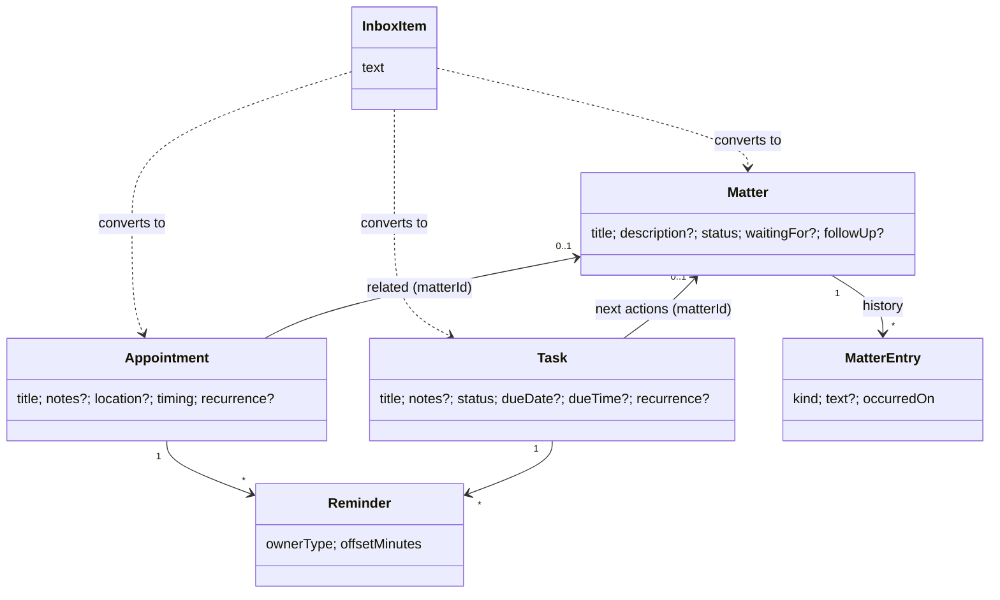

# Domain model

The entities of Prumio, field by field. `:core:model` mirrors this document exactly; the database
schema ([database-schema.md](../architecture/database-schema.md)) and the backup format
([backup-format.md](backup-format.md)) are derived from it.

Conventions: `Instant` = `kotlin.time.Instant` (UTC). `LocalDate`, `LocalTime`, `LocalDateTime`,
`TimeZone`, `DayOfWeek` = kotlinx-datetime. `?` = optional (null when absent). Limits come from
BR-GEN-002. Every entity has `id`, `createdAt`, `updatedAt` (BR-GEN-003, BR-GEN-004).

## Overview



## InboxItem

A captured thought. Phase 1.

| Field | Type | Rules |
|---|---|---|
| `id` | `InboxItemId` | UUID |
| `text` | `String` | 1–2 000 chars, trimmed (BR-INBOX-001) |
| `createdAt` | `Instant` | Order key (BR-INBOX-003) |
| `updatedAt` | `Instant` | |

## Task

A concrete action. Phase 1 (recurrence: phase 5).

| Field | Type | Rules |
|---|---|---|
| `id` | `TaskId` | |
| `title` | `String` | 1–500 (BR-TASK-001) |
| `notes` | `String?` | ≤ 10 000 |
| `status` | `TaskStatus` | `Open`, `Completed`, `Dismissed` (BR-TASK-003) |
| `dueDate` | `LocalDate?` | Floating (BR-TIME-001) |
| `dueTime` | `LocalTime?` | Requires `dueDate` (BR-TASK-002) |
| `recurrence` | `TaskRecurrence?` | Requires `dueDate`. `TaskRecurrence(rule: RecurrenceRule, basis: RecurrenceBasis)` |
| `matterId` | `MatterId?` | Next action of that matter (BR-TASK-008) |
| `completedAt` | `Instant?` | Non-null iff `status == Completed` |
| `dismissedAt` | `Instant?` | Non-null iff `status == Dismissed` |
| `createdAt`, `updatedAt` | `Instant` | |

Derived (pure, in `:core:model`): `hasDueTime`, `isRecurring`, `isOpen`.
Derived (domain, needs the clock): `isOverdue(now, zone)` (BR-TASK-004).

`RecurrenceBasis` = `FromDueDate` (default) | `FromCompletion` (BR-REC-005).

## TaskCompletion

Log of completions of recurring tasks (BR-REC-007). Phase 5.

| Field | Type | Rules |
|---|---|---|
| `id` | `String` (UUID) | |
| `taskId` | `TaskId` | Cascade delete with the task |
| `occurrenceDate` | `LocalDate` | The due date that was completed |
| `completedAt` | `Instant` | |

## Appointment

Where you need to be. Phase 1 (recurrence and exceptions: phase 5).

| Field | Type | Rules |
|---|---|---|
| `id` | `AppointmentId` | |
| `title` | `String` | 1–500 |
| `notes` | `String?` | ≤ 10 000 |
| `location` | `String?` | ≤ 500, free text (no maps, no network) |
| `timing` | `AppointmentTiming` | See below (BR-APPT-001, BR-APPT-002) |
| `recurrence` | `RecurrenceRule?` | Phase 5 |
| `matterId` | `MatterId?` | Optional related matter |
| `createdAt`, `updatedAt` | `Instant` | |

```kotlin
sealed interface AppointmentTiming {
    /** Fixed instant(s), anchored to [timeZone] (BR-TIME-002). end == null means "no end time". */
    data class Timed(val start: LocalDateTime, val end: LocalDateTime?, val timeZone: TimeZone) : AppointmentTiming

    /** Floating whole days, inclusive (BR-TIME-001). */
    data class AllDay(val startDate: LocalDate, val endDate: LocalDate) : AppointmentTiming
}
```

## AppointmentException

Changes to a single occurrence of a recurring appointment (BR-REC-008). Phase 5.

| Field | Type | Rules |
|---|---|---|
| `appointmentId` | `AppointmentId` | Part of the key |
| `originalStart` | `LocalDateTime` (or `LocalDate` for all-day) | Part of the key: which occurrence |
| `kind` | `Cancelled` \| `Modified` | |
| `override` | title/notes/location/timing, all optional | Only for `Modified` |

## Matter

Life's unfinished business. Phase 1.

| Field | Type | Rules |
|---|---|---|
| `id` | `MatterId` | |
| `title` | `String` | 1–500 (BR-MATTER-001) |
| `description` | `String?` | ≤ 10 000 |
| `status` | `MatterStatus` | `Open`, `Waiting`, `Resolved` (BR-MATTER-002) |
| `waitingFor` | `String?` | ≤ 500; only while `Waiting` (BR-MATTER-004) |
| `followUpDate` | `LocalDate?` | Only while unresolved (BR-MATTER-009) |
| `followUpTime` | `LocalTime?` | Requires `followUpDate` |
| `resolvedAt` | `Instant?` | Non-null iff `Resolved` |
| `lastActivityAt` | `Instant` | BR-MATTER-012 |
| `createdAt`, `updatedAt` | `Instant` | |

Derived (domain): `nextAction` (BR-MATTER-005), `needsAttention` (BR-MATTER-010), `isStalled` (BR-MATTER-011).

## MatterEntry

One line of a matter's history. Phase 1.

| Field | Type | Rules |
|---|---|---|
| `id` | `MatterEntryId` | |
| `matterId` | `MatterId` | Cascade delete with the matter |
| `kind` | `MatterEntryKind` | See below |
| `text` | `String?` | Note text (≤ 5 000) or a snapshot of the related task title |
| `fromStatus`, `toStatus` | `MatterStatus?` | Only for `StatusChanged` |
| `taskId` | `TaskId?` | Only for action entries; may point to a deleted task (snapshot `text` keeps the title) |
| `occurredOn` | `LocalDate` | Shown date. Notes may be backdated, never future (BR-MATTER-008) |
| `createdAt`, `updatedAt` | `Instant` | Tie-breaker for ordering |

`MatterEntryKind`: `Created`, `Note`, `StatusChanged`, `ActionLinked`, `ActionCompleted`,
`ActionDismissed`, `ActionUnlinked`, `FollowUpSet`, `FollowUpCleared`.
Only `Note` entries are editable or deletable. Action entries keep a snapshot of the task title in
`text`; `FollowUpSet` entries carry the follow-up as ISO text (`2026-11-14` or `2026-11-14T09:00`).

## Reminder

A wish to be notified relative to an item's anchor (BR-REM-004). Phase 4.

| Field | Type | Rules |
|---|---|---|
| `id` | `ReminderId` | |
| `owner` | `ReminderOwner` | `Task(TaskId)` or `Appointment(AppointmentId)` |
| `offsetMinutes` | `Int` | ≥ 0; minutes **before** the anchor. 0 = at time |
| `createdAt` | `Instant` | |

At most 5 reminders per item, unique offsets per item. Presets: 0, 5, 10, 15, 30, 60, 120 minutes,
1 day (1 440), 2 days (2 880), 1 week (10 080). Matters do not use this entity: the follow-up is
their implicit reminder.

## RecurrenceRule

Phase 5. Specification and algorithm: [recurrence.md](recurrence.md).

```kotlin
data class RecurrenceRule(
    val frequency: Frequency,              // Daily, Weekly, Monthly, Yearly
    val interval: Int = 1,                 // >= 1
    val weekdays: Set<DayOfWeek> = emptySet(),   // Weekly only; empty = weekday of the anchor
    val monthly: MonthlyPattern? = null,   // Monthly only: DayOfMonth(day) | NthWeekday(ordinal: 1..4 or -1, weekday)
    val end: RecurrenceEnd = RecurrenceEnd.Never, // Never | AfterCount(count >= 1) | Until(date)
)
```

## Scheduling state (owned by the reminder subsystem)

Not user data; never exported in backups. Phase 4.

| Entity | Fields | Purpose |
|---|---|---|
| `ScheduledAlarm` | `key: AlarmKey`, `triggerAt: Instant`, `requestCode: Int` | What the OS currently has scheduled |
| `Snooze` | `key: AlarmKey`, `until: Instant` | Active snoozes (BR-REM-007) |
| `DeliveredAlarm` | `key: AlarmKey`, `deliveredAt: Instant` | Prevents double delivery (BR-REM-009); pruned after 30 days |

`AlarmKey` is a deterministic string `"<kind>:<ownerId>:<anchorEpochMinute>:<offsetMinutes>"`
(kinds: `task`, `appointment`, `matter`, `summary`, `review`).

## Settings

Typed view over the `setting` key-value table: `Settings(theme: ThemePreference, weekStart: DayOfWeek?)`
in `:core:model`, keys in `SettingKeys` (`:core:domain`). Implemented keys: `theme`, `week_start`;
later phases add theirs. Every key has a default (BR-SET-001).

| Key | Type | Default | Phase |
|---|---|---|---|
| `theme` | `System` \| `Light` \| `Dark` | `System` | 3 |
| `default_reminder_time` | `LocalTime` | 09:00 | 4 |
| `default_appointment_notice_minutes` | `Int` | 30 | 4 |
| `morning_summary_enabled` | `Boolean` | false | 5 |
| `morning_summary_time` | `LocalTime` | 08:00 | 5 |
| `quiet_hours_enabled` | `Boolean` | false | 5 |
| `quiet_hours_start` | `LocalTime` | 22:00 | 5 |
| `quiet_hours_end` | `LocalTime` | 07:00 | 5 |
| `week_start` | `DayOfWeek?` | null = locale default | 3 |
| `stalled_matter_days` | `Int` | 14 | 6 |
| `weekly_review_enabled` | `Boolean` | false | 6 |
| `weekly_review_day` | `DayOfWeek` | Sunday | 6 |
| `weekly_review_time` | `LocalTime` | 18:00 | 6 |
| `last_reviewed_at` | `Instant?` | null | 6 |
| `auto_backup_enabled` | `Boolean` | false | 5 |
| `auto_backup_folder` | `String?` (platform URI) | null, device-specific | 5 |
| `last_backup_at` | `Instant?` | null, device-specific | 5 |
| `onboarding_completed` | `Boolean` | false, device-specific | 6 |

## Label (phase 6)

| Field | Type | Rules |
|---|---|---|
| `id` | `String` (UUID) | |
| `name` | `String` | 1–50, unique (case-insensitive) |
| `color` | `LabelColor` | One of 8 design-system colors |

Assigned to tasks, appointments and matters through a join table. Optional everywhere.

Phase 4 owner aggregates expose `reminders: List<Reminder>` so owner edits, history and reminder
wishes are persisted atomically. Draft offsets: null preserves/applies defaults; an explicit empty
list removes wishes. Permission denials (0–2) and banner dismissal are device-specific settings.
