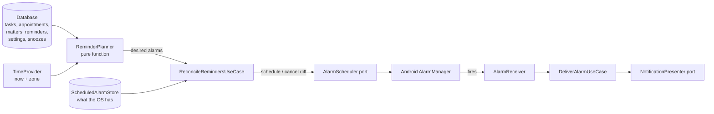

# Reminders and notifications

Reminders are the heart of Prumio: the promise that the app remembers for you. This document
specifies how that promise is kept offline, reliably and predictably. Rules: BR-REM-001 … BR-REM-018,
BR-GEN-006, BR-MATTER-009, BR-TASK-006, BR-APPT-004. Implemented in phases 4 and 5.

## Principle: notifications are derived from data (BR-REM-001)

The database is the only source of truth. Scheduled alarms are a **projection** of it, recomputed
whenever anything relevant changes — like a view. Nobody "schedules a notification"; they change
data and the projection follows.



Benefits: idempotent (running it twice changes nothing), self-healing (any trigger fixes any drift),
fully unit-testable without Android (the planner and reconciler are pure Kotlin), and portable to iOS
(only the two ports change).

## Components

| Component | Module | Kind | Responsibility |
|---|---|---|---|
| `ReminderPlanner` | `:core:domain/reminder` | pure function | `(PlanningInput) -> List<PlannedAlarm>` |
| `ReconcileRemindersUseCase` | `:core:domain/reminder` | use case | Load input, plan, diff against `ScheduledAlarmStore`, apply via `AlarmScheduler` |
| `DeliverAlarmUseCase` | `:core:domain/reminder` | use case | When an alarm fires: re-validate, build `NotificationContent`, present, record delivery, reconcile |
| `SnoozeAlarmUseCase`, `CompleteTaskFromNotificationUseCase` | `:core:domain/reminder` | use cases | Notification actions |
| `AlarmScheduler` | port in domain; `AndroidAlarmScheduler` in `:core:notifications` | interface | `schedule(alarm)`, `cancel(key)`, `canScheduleExact()` |
| `NotificationPresenter` | port in domain; `AndroidNotificationPresenter` | interface | `show(content)`, `cancel(itemKey)` |
| `ScheduledAlarmStore`, `SnoozeStore`, `DeliveredAlarmStore` | ports in domain; SQLDelight in `:core:data` | interfaces | Persistent scheduling state |
| Receivers + `ReconcileWorker` | `:core:notifications` (androidMain) | Android | Triggers (BR-REM-002) |

Signatures: [architecture/contracts.md](../architecture/contracts.md#reminders-phase-4).

## Planning (BR-REM-003 … BR-REM-005, BR-REM-009 … BR-REM-012)

```kotlin
data class PlanningInput(
    val now: Instant,
    val zone: TimeZone,
    val settings: ReminderSettings,          // default time, quiet hours, summary, review
    val tasks: List<TaskWithReminders>,      // open tasks with a due date and ≥ 1 reminder
    val appointments: List<AppointmentWithReminders>,
    val matters: List<Matter>,               // unresolved with follow-up
    val snoozes: Map<AlarmKey, Instant>,
    val delivered: Set<AlarmKey>,            // within the catch-up window
)

data class PlannedAlarm(
    val key: AlarmKey,
    val triggerAt: Instant,
    val kind: AlarmKind,                     // Task, Appointment, MatterFollowUp, MorningSummary, WeeklyReview
    val itemId: String?,
    val anchor: Instant,
    val priority: AlarmPriority,             // TimeCritical | Deferrable (BR-REM-011)
)
```

Algorithm:

1. **Expand anchors** (BR-REM-004) for the window `[now − 12 h, now + 14 days]`:
   - Task: `dueDate` at `dueTime ?: defaultReminderTime` in `zone`. One anchor (the current due date).
   - Appointment: each occurrence start in the window (all-day: first day at default time).
   - Matter: `followUpDate` at `followUpTime ?: defaultReminderTime`.
   - Morning summary: next `morningSummaryTime` (today if still ahead, else tomorrow), if enabled.
   - Weekly review: next configured weekday/time, if enabled.
2. **Triggers**: for each anchor × reminder offset → `trigger = anchor − offset`.
   `key = "<kind>:<itemId>:<anchorEpochMinute>:<offset>"`.
3. **Priority**: TimeCritical when the anchor time was explicitly set on the item; otherwise Deferrable.
4. **Snoozes**: if a snooze exists for the key, `trigger = snooze.until` (even if the original passed).
5. **Past triggers** (BR-REM-009): trigger < now → if `now − trigger < 12 h` and key ∉ delivered,
   deliver now as Deferrable ("catch-up"); else drop.
6. **Quiet hours** (BR-REM-010): Deferrable triggers inside quiet hours move to quiet-hours end.
7. **Limit**: sort by trigger, keep the first 200 (BR-REM-003). Deterministic for equal triggers (sort by key).

The planner never reads the clock or the database itself — everything comes in `PlanningInput`,
which makes it exhaustively testable.

## Reconciliation (BR-REM-002)

```
reconcile():
  desired   = planner(loadInput())
  scheduled = scheduledAlarmStore.all()
  for key in scheduled.keys − desired.keys:            alarmScheduler.cancel(key)
  for alarm in desired where scheduled[key]?.triggerAt != alarm.triggerAt: alarmScheduler.schedule(alarm)
  scheduledAlarmStore.replaceAll(desired)
```

Triggers: app start · debounced (1 s) observation of reminder-relevant tables and settings ·
`BOOT_COMPLETED` · `MY_PACKAGE_REPLACED` · `TIME_SET` · `TIMEZONE_CHANGED` ·
`SCHEDULE_EXACT_ALARM_PERMISSION_STATE_CHANGED` · after each delivery · periodic `ReconcileWorker`
(every 24 h, no constraints). Reconciliation is serialized with a mutex; concurrent requests collapse.

## Delivery

When an alarm fires, `AlarmReceiver` (with `goAsync()`) calls `DeliverAlarmUseCase(key)`:

1. Re-plan for "now" and check the key is still desired (the item may have changed since scheduling).
   If not → reconcile and stop. Nothing stale is ever shown.
2. Build `NotificationContent` (title, body, actions, deep link) from current data; localized strings.
3. Show it (BR-REM-015: notification id derived from the item, so it replaces the previous one).
4. Record `DeliveredAlarm`; delete the snooze for that key; reconcile.

Content:

| Kind | Title | Body | Actions | Channel |
|---|---|---|---|---|
| Task | task title | "Due 15:30" / "Due today" / "Overdue since Mon" | Complete · Snooze | Reminders |
| Appointment | appointment title | "In 1 hour · 16:00 · location" | Snooze | Reminders |
| Matter follow-up | matter title | "Check again: waiting for <waitingFor> since <date>" | Snooze (Tomorrow) | Follow-ups |
| Morning summary | "Your day" | "3 tasks · 1 appointment at 16:00 · 4 matters need attention" | — | Summaries |
| Weekly review | "Weekly review" | "A calm look at your week is ready" | — | Summaries |

## Android specifics (phase 4)

| Concern | Decision |
|---|---|
| Exact timing | `setExactAndAllowWhileIdle(RTC_WAKEUP)` when `canScheduleExactAlarms()`; else `setAndAllowWhileIdle` (inexact) and BR-REM-013 messaging |
| Permission | `SCHEDULE_EXACT_ALARM` (user-granted). `USE_EXACT_ALARM` is evaluated at store submission (ADR-0014) |
| Notification permission | `POST_NOTIFICATIONS` on Android 13+, asked contextually (BR-REM-014) |
| Boot | `RECEIVE_BOOT_COMPLETED` → reconcile |
| Doze / OEM battery savers | allow-while-idle alarms; Settings → Reminder reliability explains battery optimization with a link to system settings (no `REQUEST_IGNORE_BATTERY_OPTIMIZATIONS`) |
| PendingIntent identity | data URI `prumio://alarm/<key>`; request code from `ScheduledAlarm.requestCode` (unique, persisted) |
| Deep links | `prumio://task/<id>`, `prumio://appointment/<id>`, `prumio://matter/<id>`, `prumio://today` handled by `MainActivity` → back stack `[Today, Detail]` (BR-REM-017) |

## iOS (only when explicitly requested)

`AlarmScheduler` + `NotificationPresenter` implemented with `UNUserNotificationCenter`. iOS allows
64 pending notifications, so the iOS adapter keeps only the first 64 planned alarms (the planner's
ordering already prioritizes them) and reconciliation runs on app open, background refresh and
notification delivery. Nothing in the domain changes.

## Honesty about reliability

Prumio makes reminders as reliable as the OS allows and **tells the user** when it cannot
(denied permissions, inexact alarms, aggressive battery savers). It never promises guaranteed
delivery under every device configuration.

## Test plan

- Planner: table-driven tests per rule (anchors, offsets, window, limit, snooze, catch-up, quiet
  hours across midnight, DST transitions, time zone travel), named after their BR ids.
- Reconciler: fake scheduler and store; idempotency (running twice → no calls the second time).
- Android: instrumented tests for schedule → fire → notification (emulator, API 26 and latest).
- Manual: [device QA checklist](../plan/qa/device-qa-checklist.md) (reboot, Doze, time zone change,
  permissions denied, exact alarms denied, app killed).

## Phase 4 implementation boundaries

The implemented planner uses Settings and aggregate Task/Appointment reminder lists. Recurrence,
quiet hours, summaries and weekly review remain phase 5; their sketches above describe that
future extension. Phase 4 includes the existing matter follow-up anchor. Defaults are 09:00 and
30 minutes, editable in Settings. Draft reminderOffsets=null means default/preserve; [] explicitly
removes wishes. Unchanged offsets retain their ReminderId, including delete/Undo snapshots.

ReminderCoordinator is a singleton shared across use-case instances; use cases remain factories.
Forced reconciliation restores all desired OS alarms after boot/update/time/exact-access changes,
even if the persisted projection is unchanged. Permission-denied due alarms are deferred until
access returns, preventing a catch-up self-rescheduling loop. Wishes and future alarms are kept.
Android native resources localize notification text; Android date/time formats respect locale,
12/24-hour preference and the injected zone. Notification tag=itemKey/id=0 avoids hash collisions.
Dismissal never changes item state. Delivery records are pruned after 30 days.

See ADR-0022 for the daily WorkManager safety net and ADR-0023 for the additive pre-release schema
bridge. No signed/public release is claimed before the owner's key and G4 sign-off exist.
