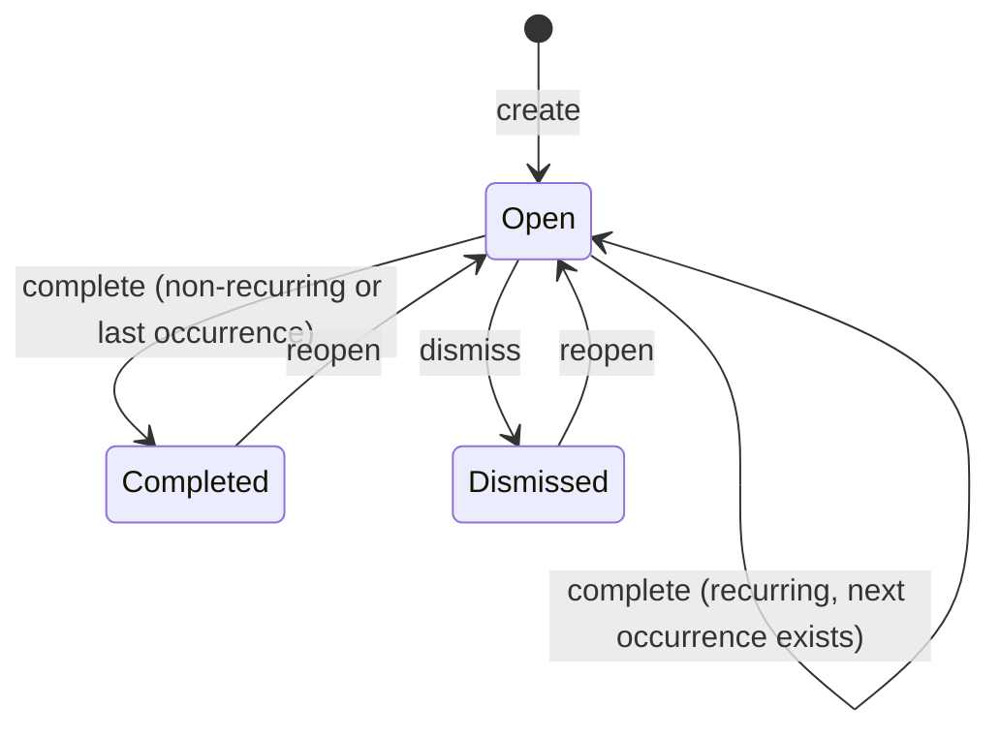
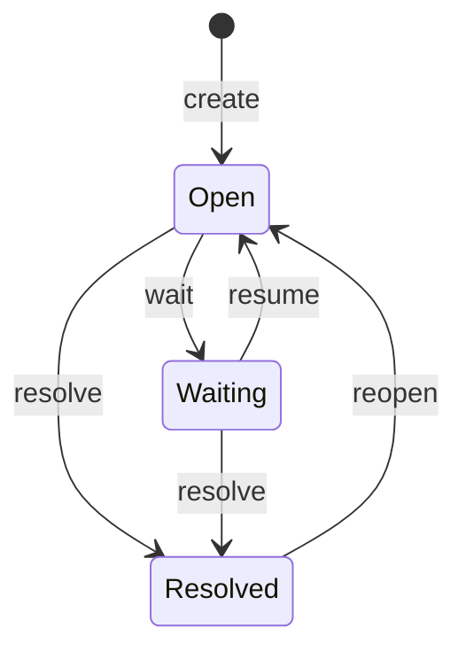
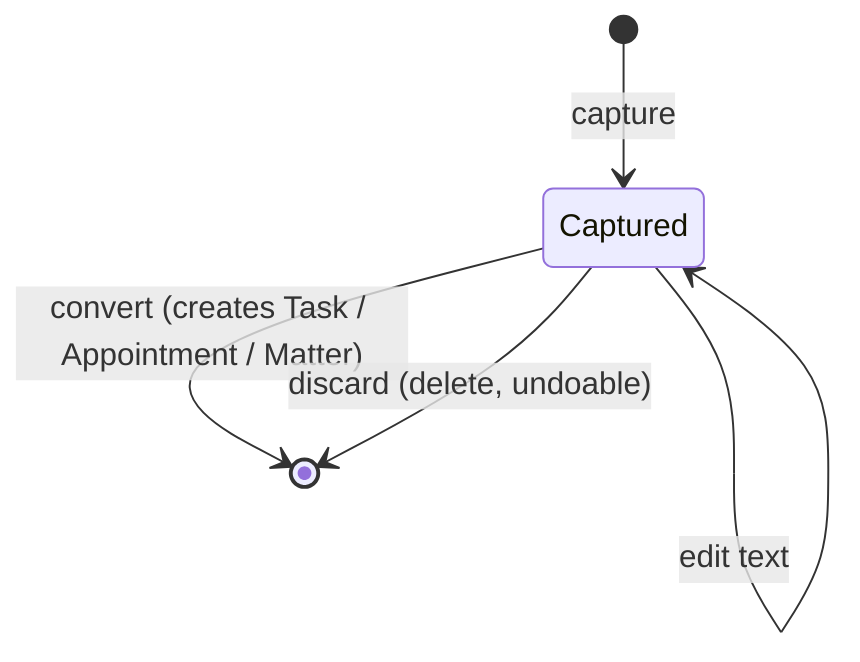
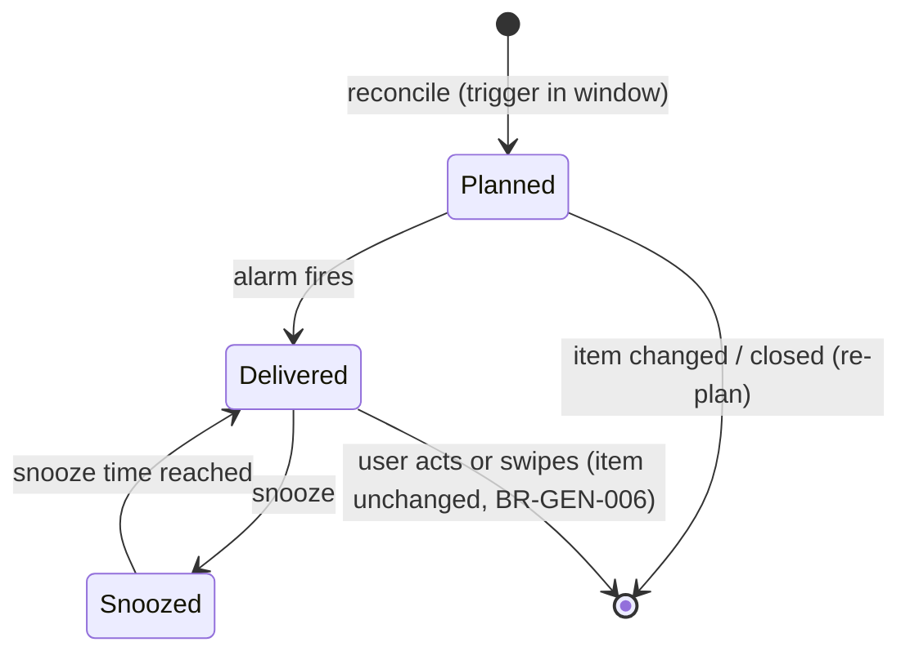

# State machines

Every status change in Prumio follows one of these machines. A transition not listed here is
invalid and returns `DomainError.InvalidTransition(ruleId, from, to)`. Side effects listed for a
transition happen **in the same transaction**.

## Task

Rule: BR-TASK-003 (recurring tasks: BR-TASK-005).

| Transition | Preconditions | Side effects |
|---|---|---|
| create → Open | valid title (BR-TASK-001) | If `matterId`: `ActionLinked` entry on the matter |
| Open → Completed | — | `completedAt = now`; if linked: `ActionCompleted` entry, BR-MATTER-006 prompt |
| Open → Open (recurring) | has recurrence with a next occurrence | `TaskCompletion` record; `dueDate` = next (BR-REC-005); snoozes cleared |
| Open → Dismissed | — | `dismissedAt = now`; if linked: `ActionDismissed` entry |
| Completed/Dismissed → Open | — | clear `completedAt`/`dismissedAt`; if linked to a resolved matter, the link is removed (`ActionUnlinked` entry) |

Editing fields (title, dates, notes) is allowed in every state and is not a transition.

## Matter

Rules: BR-MATTER-002 … BR-MATTER-009.

| Transition | Inputs | Side effects |
|---|---|---|
| create → Open | title | `Created` entry; `lastActivityAt = now` |
| Open → Waiting | optional `waitingFor`, optional follow-up | `StatusChanged` entry; set fields; `FollowUpSet` entry if a follow-up was given |
| Waiting → Open | — | `StatusChanged` entry; `waitingFor = null` (follow-up kept) |
| Open/Waiting → Resolved | choice for open linked tasks: dismiss (default) or unlink | `StatusChanged` entry; `resolvedAt = now`; follow-up and `waitingFor` cleared; tasks dismissed (`ActionDismissed`) or unlinked (`ActionUnlinked`) |
| Resolved → Open | — | `StatusChanged` entry; `resolvedAt = null` |

Every transition updates `lastActivityAt` (BR-MATTER-012) and triggers reminder reconciliation (BR-REM-002).

## Inbox item

Rules: BR-INBOX-001, BR-INBOX-004, BR-INBOX-006.

## Notification (delivery view)

Not stored as a status — derived by the planner (BR-REM-001). Shown for understanding.

