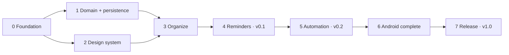

# Execution plan

How Prumio goes from foundation to **Android v1.0** — the point at which the project is complete.
Work is split into phases; each phase into small tasks an AI agent can finish in one session; each
phase closes with a validation gate signed off by the owner.

## Roadmap

| Phase | Goal | Release | Gate | Status |
|---|---|---|---|---|
| [0 — Foundation](phase-0-foundation.md) | Architecture, docs, build, quality gates, app shell | — | G0 | ✅ done (pending owner sign-off) |
| [1 — Domain and persistence](phase-1-domain-and-persistence.md) | All entities, rules and storage for v0.1, no UI | — | G1 | todo |
| [2 — Design system](phase-2-design-system.md) | Components, domain UI, screenshots, accessibility base | — | G2 | todo |
| [3 — Organize](phase-3-organize.md) | Capture, inbox, tasks, Today, agenda, matters, search, settings | — | G3 | todo |
| [4 — Reminders](phase-4-reminders.md) | Offline notifications, reliable and honest | **v0.1** | G4 | todo |
| [5 — Automation](phase-5-automation.md) | Recurrence, follow-ups, summary, quiet hours, backup | **v0.2** | G5 | todo |
| [6 — Android complete](phase-6-android-complete.md) | Review, widgets, share, voice, labels, ICS, a11y, performance | v0.3 → v0.9 | G6 | todo |
| [7 — Release](phase-7-release.md) | Store-ready v1.0 | **v1.0** | G7 | todo |
| [Future — iOS](future-ios.md) | Only when the owner explicitly requests it | — | — | dormant |

Phases 1 and 2 can run in parallel (they touch different modules). Phase 3 needs both.
Tasks inside a phase list their dependencies; independent tasks can run in parallel sessions.



## Definition of "project complete"

Gate **G7** passed: Android v1.0 published (F-Droid and/or Google Play, per owner decision) with
every `F-*` feature of releases v0.1–v1.0 in [features.md](../product/features.md), every
business rule `implemented`, and the device QA checklist passed on the device matrix. iOS is **not**
required.

## Task format

Each phase file lists tasks like this:

```markdown
### P1.07 — Inbox and task repositories
- **Status:** todo | in progress | done | blocked (reason)
- **Depends on:** P1.04, P1.06
- **Goal:** one sentence.
- **Inputs:** docs and recipes to read.
- **Deliverables:** files/behaviors that must exist at the end.
- **Rules:** BR ids implemented (flip them to `implemented`).
- **Validation:** commands to run and what to check manually.
```

## How an agent executes a task

1. Pick the first `todo` task whose dependencies are `done` (or the one the owner assigned).
2. Set its status to `in progress` in the phase file (one commit), then follow
   [docs/ai/workflow.md](../ai/workflow.md).
3. Finish with `./scripts/verify.sh` green and the [definition of done](../ai/definition-of-done.md).
4. Set the status to `done`, add a CHANGELOG line, and report.

Status lives **only** in the phase files (single source); this table shows phase-level status.

## How the owner validates

- Per task: review the agent's report and the diff (or PR). CI must be green.
- Per phase: run the gate in [validation-gates.md](validation-gates.md) — automated checks plus the
  manual items — and record the result at the end of the phase file ("Gate record").
- Dogfooding: from phase 3 on, install the debug build and use it daily; file friction as issues.
