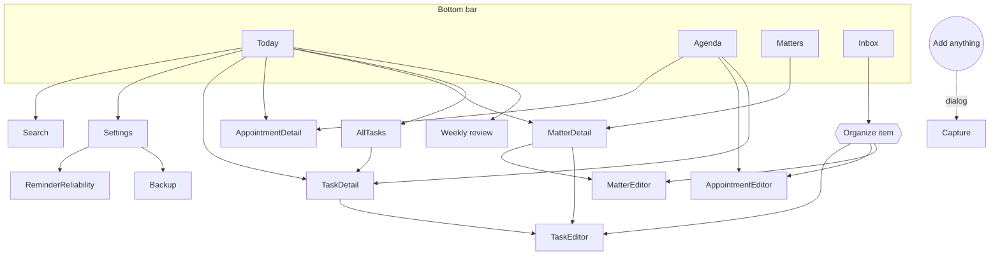

# Screens

Specification of every screen: purpose, content, actions and empty states. Visuals come from the
[design system](../design-system/README.md); behavior from [business rules](../domain/business-rules.md).
Each screen is implemented with the pattern in
[presentation-pattern.md](../architecture/presentation-pattern.md).

## Navigation map

- Four tabs, in this order: **Today · Agenda · Matters · Inbox** (Hoje · Agenda · Pendências · Entrada).
- "Add anything" (floating button) is visible on every tab and opens Quick capture as a dialog.
- Back from any non-root screen pops one level; back from a tab other than Today returns to Today
  (docs/architecture/navigation.md#back-stack-rules).

## Today

`TodayKey` · `:feature:today` · rules BR-TODAY-*

1. **Header**: date as overline ("WEDNESDAY, 11 NOV"), greeting ("Good morning"), Search and Settings icons.
2. **Your day at a glance**: three tiles — Tasks · Appointments · Matters (BR-TODAY-002). Tapping a
   tile scrolls to its section (Matters tile opens the Matters tab).
3. **Inbox nudge** (when not empty): "3 items to organize" → Inbox (BR-TODAY-006).
4. **What to do today**: task rows (BR-TODAY-003) with completion control, time or "No time",
   overdue marker; "Done today (2)" collapsed at the end; "All tasks" link.
5. **Next appointment** (BR-TODAY-004): time, title, location, reminder summary ("1 hour before").
6. **Matters that deserve attention** (BR-TODAY-005): up to 5 matter cards with status and next action.

Empty day: "Your day is clear" + suggestion to capture something. Never an empty screen.

## Agenda

`AgendaKey` · `:feature:agenda` · rules BR-APPT-*, BR-TASK-004

- Header: month and a compact week strip (dots on days with items); tap a day to jump.
- Body: continuous list of days from today (sticky day headers "Today", "Tomorrow", "Fri, 14 Nov"),
  ordered by BR-APPT-007. Past days reachable by scrolling up / picking a date.
- Actions: add appointment for the selected day; tap appointment → detail; tap task → task detail.
- Empty upcoming week: "Nothing scheduled this week".

### Appointment editor / detail

Fields: title*, all-day switch, start date*, start time*, end (optional), location, notes,
reminders (advance notices), repeat (phase 5), related matter. *Required per BR-APPT-001.
Detail shows everything plus actions: Edit, Delete (undo), Link to matter.

## Matters

`MattersKey` · `:feature:matters` · rules BR-MATTER-*

- Groups (BR-MATTER-013): Needs attention · Waiting · Open · Resolved (collapsed).
- Each card: status chip (text + color), title, next action with due label, follow-up date,
  "waiting for" line.
- Action: New matter (title only is enough).
- Empty: explains what a matter is, with an example ("Sort out the car documents").

### Matter detail

1. Title, status chip, description.
2. Status actions: "Mark as waiting" (opens the waiting sheet, BR-MATTER-004) · "Resume" · "Resolve"
   (BR-MATTER-007) · "Reopen".
3. **Next action** card (BR-MATTER-005) with complete control; "Add next action" when none.
4. **Follow-up**: date/time or "Set a date to check again".
5. **History** (newest first): entries with date; "Add note" (BR-MATTER-008).
6. Other open actions (collapsed), related appointments.

## Inbox

`InboxKey` · `:feature:inbox` · rules BR-INBOX-*

- List of items, newest first, each with age ("2 days ago").
- Swipe or menu: Organize · Edit · Discard (undo).
- **Organize** sheet: "Task", "Appointment", "Matter" → converts (BR-INBOX-004) and opens the editor.
- Empty: "Inbox zero. Anything on your mind? Tap Add."

## Quick capture

`CaptureKey` (dialog) · `:feature:capture` · rules BR-INBOX-001, 002

- Single multi-line text field, focused, keyboard open. Placeholder: "What's on your mind?".
- Save button (enabled when not blank) and keyboard "done" save to the inbox and close with a short
  confirmation ("Saved to Inbox").
- Optional row of type chips (phase 3 stretch): Inbox (default) · Task · Appointment · Matter —
  saving as another type opens nothing else; it just creates that type with the title.
- Never asks for anything else.

## Tasks

`:feature:tasks` · rules BR-TASK-*

- **Task editor** (`TaskEditorKey(taskId?)`): title*, notes, due date (quick chips Today/Tomorrow/
  Next week/Pick), due time, reminders (phase 4), repeat (phase 5), matter link.
- **Task detail** (`TaskDetailKey(taskId)`): fields + actions Complete/Reopen, Postpone, Dismiss,
  Edit, Delete (undo).
- **All tasks** (`AllTasksKey`): segmented filter Anytime · Upcoming · Overdue · Completed (BR-TASK-009).

## Search

`SearchKey` · `:feature:search` · rules BR-SEARCH-*

- Search field focused on open; results update as you type (debounced 200 ms) once ≥ 2 characters.
- Grouped results (Tasks, Appointments, Matters, Inbox) with the matching text highlighted.
- Empty query: hint; no results: "Nothing found for 'xyz'".

## Settings

`SettingsKey` · `:feature:settings` · rules BR-SET-*, BR-REM-010…014, BR-BACKUP-*

Sections:
1. **Appearance**: theme (System/Light/Dark); language (opens Android per-app language settings).
2. **Reminders**: default reminder time, default appointment notice, morning summary (on/time),
   quiet hours (on/start/end), weekly review reminder (phase 6), **Reminder reliability** →
   checklist with status and fix buttons: notifications allowed, exact alarms allowed, battery
   optimization info.
3. **Backup**: Export now, Import, Automatic backup (folder, on/off, last run), Encrypted (phase 6).
4. **About**: version, source code link (text, opens browser), licenses, privacy statement
   ("Prumio has no internet access…").

## Weekly review (phase 6)

`ReviewKey` · `:feature:review` (created in phase 6) · rules BR-REVIEW-*

Sections from BR-REVIEW-001, each with inline actions; "Done for this week" at the end. No scores.

## Onboarding (phase 6)

Three calm screens: what Prumio is (capture · tasks · agenda · matters); privacy promise; optional
choices (notifications permission with explanation, morning summary on/off). Skippable.

## Widgets (phase 6)

- **Today widget**: date, next appointment, up to 5 tasks with completion control, "+" capture button.
- **Quick capture widget**: one tap opens Quick capture.
